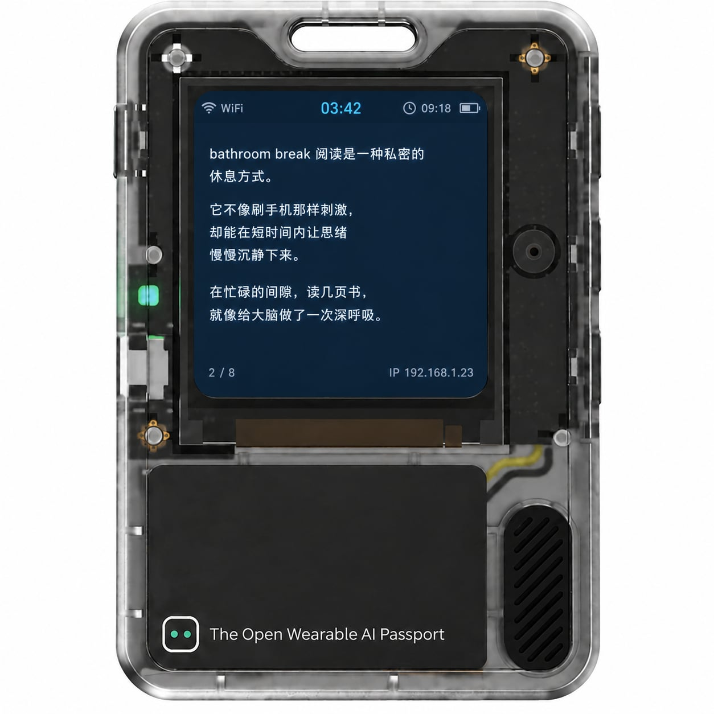

 <a href="README.md">简体中文</a> · <strong>English</strong>

# Bathroom Short-Read

> [!IMPORTANT]
> **Learn the play and flash the firmware in your browser. Start on the community page:**
>
> ## [Bathroom Short-Read · community play (learn + browser flash)](https://ai-passport.folotoy.cn/plays/1427/?v=3375-3)
>
> This page is the best way to learn the play and to flash firmware directly in the browser. Use it for install and flash.

A Chinese short-reading play based on [FoloToy AI Passport](https://github.com/FoloToy/ai-passport).  
Current version: **v1.2.0** · play source is on branch `feature/bathroom-short-read`.  
To download the firmware file yourself, use the secondary [Release v1.2.0](https://github.com/RadyWu/ai-passport/releases/tag/v1.2.0-bathroom-short-read).

> The GitHub homepage is the Chinese `README.md` on the default branch `main`. Play source is on branch `feature/bathroom-short-read`.

---

## Introduction

Scroll a phone while you are on the toilet and the feed pulls you in — you fall into the trap set to keep you there — or a game hooks you until half an hour has passed. Your legs go numb, and it is bad for you. Leave the phone behind and it is just boring.

Now there is this bathroom reader. It turns AI Passport into an AI short-piece generator. Enter a DeepSeek API Key and it writes what you like to read from the prompt you saved. Each fetch is a different topic, so it stays fresh. A piece is a little over a thousand characters, about right for 3 to 5 minutes of reading. So you do not keep refreshing and stay seated, the program allows only one new fetch every 10 minutes. Finish a piece, and it is time to get up.

It uses the fastest and cheapest model by default. API token use is tiny: during development, dozens of fetches in a day cost only a few cents. The 6 yuan of tokens included with DeepSeek Harness lasts a very long time.

---

## Screen layout

> **Mock only, not a photo of the device.** The picture above is an AI-made layout sketch so the screen arrangement is easier to follow. After you flash the firmware, the device screen is what counts.

## How to use

* First-time setup (Wi‑Fi): After flashing this play’s full firmware and powering on, the screen prompts for provisioning. Connect your phone to the device hotspot `AIPassport-XXXX` (XXXX is the device suffix) and open `http://192.168.4.1/` in a browser. On the config page enter: **2.4 GHz** Wi‑Fi name and password (you can fill in up to 3 networks; the system will try them in turn), your **DeepSeek API Key**, and a preference prompt for what you like to read. After you tap Save, the device connects immediately. When online, the screen shows the LAN IP. A successful first provisioning automatically fetches one short article.
* Reading: Single-click Up / Down to turn pages; double-click Up to jump back to the first page.
* Brightness: Long-press Up / Down to step the screen brightness.
* New article: Long-press OK, confirm when prompted, then fetch (at most once every 10 minutes).
* Double-click OK, or leave idle for 10 minutes, to enter deep sleep and save power; press any function key to wake and resume at the last reading position.
* After 5 minutes of use, a reminder prompts you to get up and stretch.
* On the same Wi‑Fi you can also open `http://<device-IP>/` in a browser to change settings; if already provisioned, the fields are prefilled with the last Wi‑Fi, API Key, and related values.
* Never show your API Key in screenshots or public shares. Apply for a DeepSeek API Key on their website and watch your quota.

---

## Download and flash

**Preferred:** learn the play and flash in the browser from the community page:

**[Bathroom Short-Read · community play (learn + browser flash)](https://ai-passport.folotoy.cn/plays/1427/?v=3375-3)**

The GitHub Release is a secondary path when you want the firmware file itself:

1. Open [v1.2.0 Bathroom Short Read](https://github.com/RadyWu/ai-passport/releases/tag/v1.2.0-bathroom-short-read)
2. Download the full firmware `FoloToy-AI-Passport-full-v1.2.0-1021.bin`. `FoloToy-AI-Passport-full.bin` in the same Release is the latest full image, and the bytes are the same.
3. Flash it from `0x0` with the official FoloToy web flasher. Use the full merged image, not an app-only binary.

Flashing can reset the saved Wi‑Fi and API Key. Set the device up again as in “First-time setup” above.

---

## Source and branches

| Item | Detail |
| --- | --- |
| Play branch | `feature/bathroom-short-read` |
| Release tag | `v1.2.0-bathroom-short-read` |
| Upstream | [FoloToy/ai-passport](https://github.com/FoloToy/ai-passport) |

This page is `README.en.md`. The repository homepage is the Chinese `README.md` on `main`.

---

## License

Same as upstream. See `LICENSE` (MIT).
